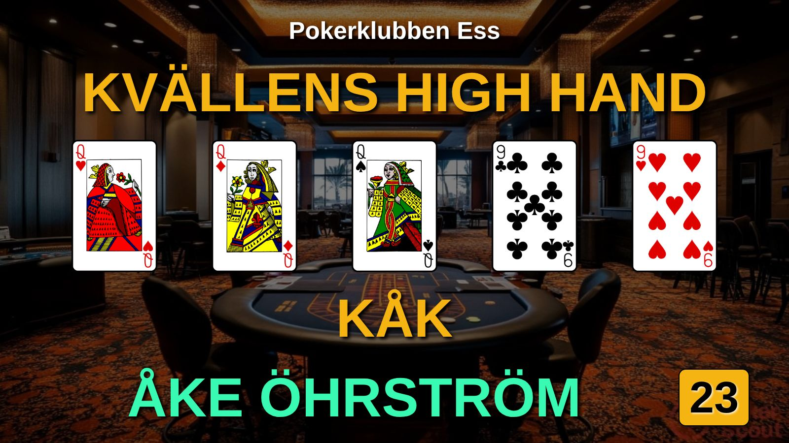
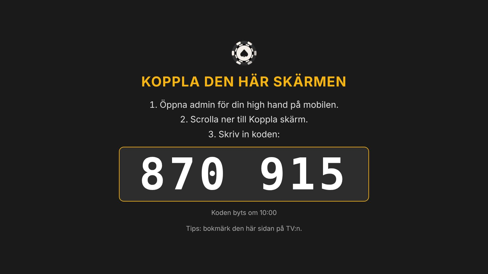
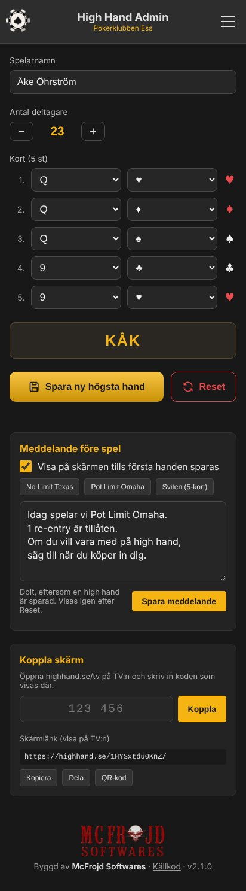

# High Hand

Visa kvällens high hand på en TV-skärm och uppdatera den från mobilen. Det är gratis och kräver inget konto.

**👉 [highhand.se](https://highhand.se)**

## Kom igång

1. Gå till **[highhand.se](https://highhand.se)**, välj språk (svenska eller engelska) och skriv gärna in klubbens namn. Klicka på **Skapa**.
2. Du får två länkar. **Spara dem**, för de kan inte återskapas:
   - **Skärmlänk** `highhand.se/<nyckel>/` visar high hand på TV:n.
   - **Adminlänk** `highhand.se/<nyckel>/admin/` används för att uppdatera från mobilen.

Varje länk har knapparna **Kopiera**, **Dela** och **QR-kod**, så att det är enkelt att öppna dem på en annan enhet.

## Visa på TV:n

Det enklaste sättet, utan att skriva in någon lång adress på TV:n:

1. Öppna **highhand.se/tv** i TV:ns webbläsare. Bokmärk sidan, så räcker det nästa gång.
2. TV:n visar en sexsiffrig kod.
3. Öppna admin på mobilen, scrolla ner till **Koppla skärm** och skriv in koden. TV:n byter direkt till din high hand.

Koden gäller i 10 minuter och kan bara användas en gång.
Om TV:ns senaste skärm fortfarande är aktiv visar `highhand.se/tv` en knapp för att fortsätta till den.
När en nyckel går ut återgår TV:n automatiskt till kodsidan.

Det fungerar också att öppna skärmlänken direkt i valfri webbläsare och visa den i fullskärm.

## Uppdatera high hand

I admin gör du så här:

- **Spelarnamn:** namnet på den som har handen.
- **Antal deltagare:** använd − och +. Ändringen syns direkt på skärmen.
- **Kort:** välj värde och färg för de fem korten.
  - Samma kort kan inte väljas två gånger.
  - Nästa kort föreslår samma färg som kortet före, så det går snabbt att mata in en färg eller färgstege.
- **Handen** räknas ut automatiskt när alla fem kort är valda. Du kan ändra den för hand om det behövs.
- Klicka på **Spara ny högsta hand**. Skärmen uppdateras direkt.
- **Reset** nollställer skärmen efter turneringen.

I menyn **☰** kan du ändra klubbnamn, språk (svenska eller engelska) och bakgrund.
Där kan du också **ladda upp en egen bakgrundsbild**, till exempel ett foto från mobilen.
Bilden förminskas automatiskt, och en ny uppladdning ersätter den förra. Bilden raderas när nyckeln går ut.

## Bra att veta

- Flera klubbar kan använda tjänsten samtidigt. Varje skärm har sin egen nyckel.
- En nyckel **raderas automatiskt 48 timmar** efter att den skapats. Skapa en ny inför nästa turnering.
- Den som känner till nyckeln kan öppna både skärmen och admin. Dela därför adminlänken bara med dem som ska uppdatera.
- Klubbnamn och high hand sparas i upp till 30 dagar för statistik.

## Om projektet

Byggd av **McFrojd Software**.
Teknisk dokumentation för utveckling och drift finns i [docs/DEVELOPMENT.md](docs/DEVELOPMENT.md).
